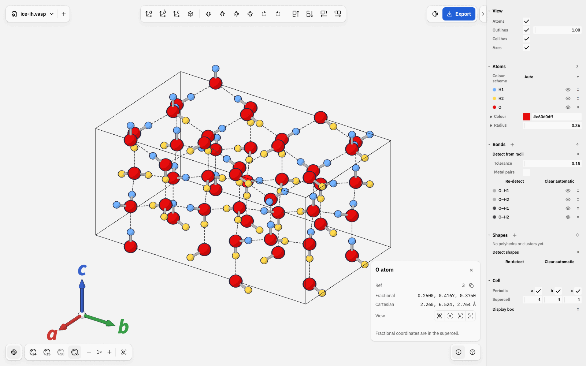
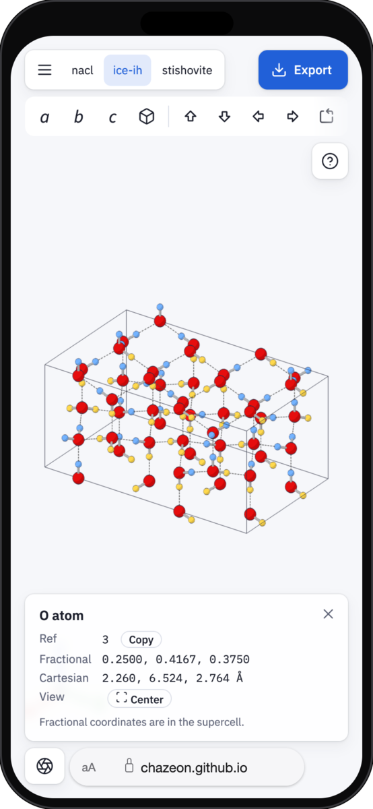
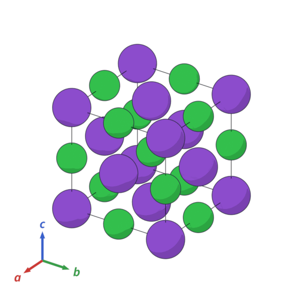
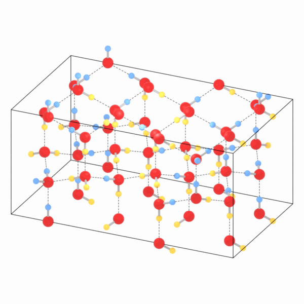
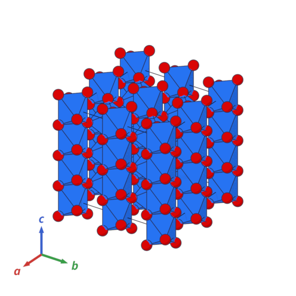
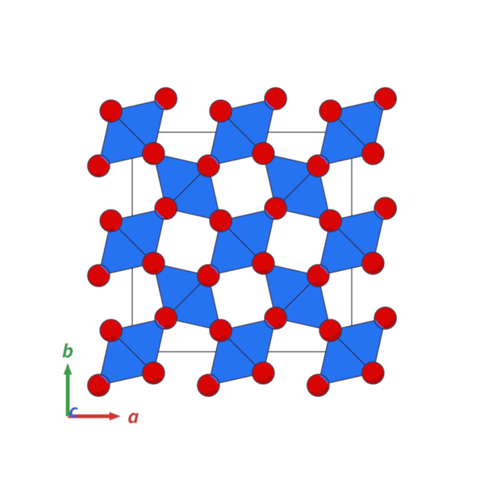

# gemmy

Crystal structure pictures, in the browser and in Blender. gemmy reads a structure (POSCAR, extxyz, cif, ...) and a
small config, works out which atoms, bonds and coordination polyhedra to draw, and writes that down as a
`scene.json`. The same scene then goes to:

- **the web viewer** (three.js, no Blender): a live preview while you edit the config, or a static page to put online;
- **Blender**, for the final picture.

```bash
gemmy serve config.toml                                   # live preview at http://127.0.0.1:8000/
gemmy compile config.toml --out scene.json                # config.toml names its structure file
gemmy render --scene scene.json --look.preset 3to2d --out picture.png
```

Try the web viewer on the examples: **https://chazeon.github.io/gemmy/**

<p align="center">
  
  
</p>

Blender renders of the examples (`3to2d` look):

| NaCl | ice Ih | stishovite | stishovite down c |
|---|---|---|---|
|  |  |  |  |

## Install

```bash
git clone https://github.com/chazeon/gemmy.git
cd gemmy
uv sync            # or: pip install -e '.[dev]'
```

- **Compile and the web viewer** need Python 3.11+ with numpy, scipy, ASE, pydantic and tyro, all installed with
  the package. The viewer page loads three.js from jsDelivr (pinned to 0.160.0).
- **Blender renders** need Blender 4.2 LTS or newer. `gemmy render` finds it via `--blender PATH`, `$BLENDER`,
  `PATH` or the usual install locations, and runs it in the background.

## How it works

1. **compile** (normal Python: ASE, numpy, scipy): structure + config → `scene.json`. All the structure logic lives
   here: supercells, periodic images, bonds, polyhedra, labels, selection, displacement arrows.
2. **draw**: the web viewer or Blender reads `scene.json` and only places what it is told. Blender's side is stdlib +
   `bpy`; the viewer is one HTML page.

The scene file is the contract between the two. It is plain JSON you can read, diff and keep, and structure bugs are
debugged with ordinary Python and unit tests. The viewer frames the scene exactly as Blender does, so a view chosen in
the browser renders the same in Blender.

## Examples

`examples/` has three small structures (NaCl and ice are synthetic, stishovite uses its measured cell). Each has a
`POSCAR`, the config as `config.toml` (with a `config.json` copy), a README and a `render.sh` that compiles and renders.

| Example | Shows |
|---|---|
| `examples/nacl` | periodic cell with the display box: boundary copies give the 27-atom cube |
| `examples/ice-ih` | O–H bonds completed across the cell boundary (no detached H), H1/H2 label colours, dashed H-bonds, cell box |
| `examples/stishovite` | polyhedra style: no bonds, hidden Si drawn as SiO6 octahedra, saturated red O; edge-sharing chains along c |

```bash
gemmy serve examples/nacl/config.toml examples/ice-ih/config.toml examples/stishovite/config.toml  # all three, as tabs
cd examples/stishovite && GEMMY="uv run gemmy" OUT=/tmp/stishovite ./render.sh                     # Blender
scripts/render_examples.sh    # re-render the README pictures into docs/images/
scripts/build_site.sh         # the examples as a static site in site/
scripts/update_pages.sh       # the same site, committed to the gh-pages branch
```

## Web viewer

The viewer shows a scene in the 3to2d look: flat two-tone shading, outlines, cell box and a/b/c triad.

### The page

The structure fills the window, and the controls float over it:

- **top left**: a menu with the Atoms, Outlines and Cell box toggles, then the structure name, or one tab per
  structure;
- **top centre**: look along a, b or c, or the rotated 3to2d view; tilt, turn and spin; move;
- **top right**: Export;
- **lower left**: the lens (24, 35, 50, 70, 85 mm, or ∞ for orthographic) above zoom (+, %, −, fit);
- **lower right**: ⓘ, the details of the clicked atom or polyhedron, and ?, the keyboard shortcuts.

Every control has a tooltip. Click an atom for its fractional and Cartesian position, its neighbour distances and its
`ref` (with a Copy button). Click a polyhedron for its centre, bond lengths, mean and distortion Δ.

| Keys | Does |
|---|---|
| drag · right-drag · scroll | rotate · move · zoom |
| ← → ↑ ↓ | turn and tilt (hold to keep turning) |
| `[` `]` | spin |
| Shift + arrows | move the structure |
| W S · A D · Q E | fly in/out (in perspective, through the structure) · left/right · down/up, as in Blender's fly mode (hold; keys combine) |
| Shift + W S | fly up, down |
| `+` `−` · `0` | zoom · fit to window |
| double-click | rotate around this atom or polyhedron, while it stays selected |
| `i` · `?` · `t` | details · shortcuts · theme (auto, light, dark) |
| Esc | close a menu; otherwise clear the selection and let go of its pivot |

The lens is a real lens on Blender's 36 mm sensor, and zoom moves the camera, so a perspective view renders as seen. ∞
(the default) is orthographic, the limit of an infinitely long lens. Switching lenses keeps the view direction, target
and framing.

Bonds (solid, dashed, dotted), arrows and see-through polyhedra are drawn at the same sizes as in Blender. The a/b/c
labels use the same font (Source Sans 3 italic, bundled), so they match the render too. Large scenes are drawn with
instancing, a few draw calls in total: a 5,000-atom scene turns smoothly.

### Live preview: `gemmy serve`

The previewer for editing a config by hand: save `config.toml` and the page updates, keeping the camera and toggles.

    gemmy serve examples/stishovite/config.toml

- **Serving and watching.** It compiles on start and serves `http://127.0.0.1:8000/` (`--port`, `--host`, `--open`).
  It watches the config and the files it names (`structure`, `labels.file`, `displacements.data_file`, or the
  `--poscar` file) and recompiles when one changes.
- **Compile errors** are printed in the terminal and shown in a banner. The last good scene stays on screen, and the
  banner clears on the next good compile.
- **Several configs** are tabs, served at `/0/`, `/1/`, …, each watched on its own. `--poscar`, `--title` and
  `--render` take one config only.
- **A fixed scene:** `gemmy serve --scene scene.json` serves that file and watches it.
- **With `--render fig.png`,** Blender renders that image after every good compile, in the background, one render at
  a time. Edits made during a render are merged into one more render. The render flags are those of `gemmy render`,
  and "Use this view for the Blender render" in the Export menu sends the camera and cell box to it:

      gemmy serve config.toml --render fig.png --look.preset 3to2d

### Export

The Export menu saves what is on screen:

- **PNG**: twice the window size, with the triad, on the page background or transparent.
- **SVG**: vector output of the view. three.js renders the object ids, the toon shading, the outlines and the lines, and
  decides what is visible. Each visible boundary is traced from those renders and snapped to the exact circle, ellipse
  or line it lies on in the scene; a boundary that matches none of them is a fitted Bézier. The drawing holds:
  - atoms (exact discs, with a dark toon band), polyhedra, bonds, arrows and the cell box;
  - the triad, as editable text with the font embedded.
- **Render settings** (TOML or JSON, Save or Copy) and **Render command** (Copy): the view as `gemmy render`
  settings, so Blender renders it as framed on screen. They hold the look preset, camera projection, lens,
  direction, up, zoom and target, the cell-box toggle, and a resolution with the window's aspect ratio:

      gemmy render --scene scene.json --settings render-settings.toml --out view.png

### Static pages and putting it online: `gemmy view`

`gemmy view` writes self-contained pages, with the scene embedded and no server needed:

    gemmy view scene.json --out stishovite.html --title Stishovite --subtitle "rutile-type SiO2"
    gemmy view nacl.json ice-ih.json stishovite.json --out site/

Several scenes without `--hosted` make a small site with the scenes embedded: `site/<name>/index.html` per scene, with
tabs between them. The links are relative, so the folder works under any path.

### Sharing a scene

The viewer can open a scene from an address, a gist or a file, so a scene can be shared without building a page for it.
On the published site, the front page <https://chazeon.github.io/gemmy/> is the viewer with the examples as tabs, and
<https://chazeon.github.io/gemmy/view/> opens with no scene. These are the ways to fill the viewer:

    https://chazeon.github.io/gemmy/view/?scene=https://example.org/ice-ih.json.gz
    https://chazeon.github.io/gemmy/view/?scene=../nacl/scene.json.gz&scene=../ice-ih/scene.json.gz   # tabs
    https://chazeon.github.io/gemmy/view/?gist=0123abcd                  # the first .json or .json.gz file
    https://chazeon.github.io/gemmy/view/?gist=0123abcd&file=ice.json.gz  # or the file named
    https://chazeon.github.io/gemmy/?gist=0123abcd                        # the front page takes them too

- **Addresses.** `scene=` takes any http or https address the browser may read; it is resolved against the page, so a
  relative one works on a site. The host must allow cross-origin reads (CORS), as GitHub's raw files and gists do.
  Plain JSON and gzip (`.json.gz`, detected by its first bytes) both load. Several `scene=` are tabs.
- **Gists.** A secret gist works by its id. The first `.json` or `.json.gz` file is shown unless `file=` names one.
- **Files.** Drop a `.json` or `.json.gz` anywhere on the page, or use ☰ → Open scene…. The file is read in the browser
  and never uploaded.
- **The view.** The camera is in the address too: `#view=persp;lens=50;eye=…;at=…;up=…` (or `ortho;zoom=…`), to four
  significant figures. ☰ → Copy link copies the scene's address with this view. An embedded or a local scene cannot go
  in a link, so the link then has the view only and opens the page at it.
- **Size.** A download or a decompressed scene may be at most 200 MB.

The scene is checked before it is drawn: its `schema_version` must be the one this gemmy writes.

`gemmy view --hosted` writes the site the examples are published as, the way GitHub Pages serves it: the viewer and its
stylesheet once at the root, named `viewer.<hash>.js` and `style.<hash>.css` (the hash is of their content, so an update
is never served from a cache as the old file), `<example>/scene.json.gz` and a small `<example>/index.html` for each example, the viewer
with no scene at `view/`, and the front page: the viewer with every example as a tab, so the site's root opens the
examples. `scripts/build_site.sh` builds it from the committed examples into `site/`.

The examples are published with GitHub Pages at https://chazeon.github.io/gemmy/ from the `gh-pages` branch (Settings →
Pages → Deploy from a branch → `gh-pages`, `/ (root)`). To update it, see the list of its files in
`scripts/update_pages.sh`:

    scripts/update_pages.sh       # rebuild the site and commit it to gh-pages (no Blender)
    git push github gh-pages

## Blender renders

`gemmy render --scene scene.json` builds the scene in Blender and renders it. `--look.preset` picks a starting point,
and every value it sets can still be overridden with a flag.

- `default`: Cycles, soft three-point lighting, Standard view transform (colours read as sRGB, so red is red).
- `classic`: the older AgX look with a grey backdrop.
- `3to2d`: illustration style, the look of the web viewer.
  - Flat saturated fills with two-tone toon shading.
  - Three parallel lights (key, fill, rim), with no shadows cast between atoms and polyhedra.
  - Outlines, the cell box and the a/b/c axes.
  - A rotated orthographic view (azimuth 35°, elevation 28°).
  - Hiding O (`elements.O.visible = false`) leaves only the polyhedra, which is often the cleanest picture.

```bash
gemmy render --scene scene.json --look.preset 3to2d --camera.azimuth 30 --camera.elevation 12 --out a.png
gemmy render --scene scene.json --out-dir renders --views isometric front top
gemmy render --scene scene.json --settings render-settings.toml --out view.png   # a view exported from the viewer
gemmy render --scene scene.json --gui      # open it in Blender to edit by hand
```

### Render settings

The command line is generated by [tyro](https://brentyi.github.io/tyro/) from the `RenderSettings` dataclasses in
`src/gemmy/settings.py`, and `gemmy render --help` lists every flag with its default.

- **Nesting.** Flags keep the nesting of the settings file: `--quality.samples 64` is `[quality] samples = 64`.
- **Settings file.** `--settings file.toml` (or `.json`) is loaded first, and flags override it.
- **Lists and colours** are space separated, and colours need r g b a: `--views front top`,
  `--polyhedron.edge-color 0 0 0.1 1`.
- **Booleans.** Optional booleans take a value (`--cell-box.show True`). Plain booleans toggle (`--no-soft-lighting`).

| Want | Flags |
|---|---|
| Look | `--look.preset default\|classic\|3to2d`, `--look.exposure`, `--look.view-transform`, `--look.background world\|transparent`, `--look.backdrop`, `--look.shadow 0..1`, `--look.shadow-softness DEG`, `--look.atom-shadows True\|False`, `--look.polyhedron-shadows True\|False` (both off in 3to2d) |
| Output | `--out FILE`, or `--out-dir DIR` with `--views isometric front right top ...` |
| Camera | `--camera.azimuth` + `--camera.elevation`, or `--camera.direction x y z`; `--camera.projection persp\|ortho`, `--camera.lens`, `--camera.zoom`, `--camera.target x y z`, `--camera.up x y z` |
| Polyhedra | `--polyhedron.opacity`, `--polyhedron.transmission`, `--polyhedron.edge-color`, `--polyhedron.edge-width`, `--polyhedron.scale` |
| Arrows | `--arrows.radius`, `--arrows.color`, `--arrows.head-radius-ratio`, `--arrows.head-length-ratio` |
| Quality | `--quality.engine CYCLES\|EEVEE\|WORKBENCH`, `--quality.device AUTO\|CPU\|GPU`, `--quality.samples`, `--quality.resolution W H`, `--quality.sphere-segments`, `--quality.image-format`, `--quality.instancing-threshold` |
| Cell box | `--cell-box.show`, `--cell-box.color`, `--cell-box.width` |
| Axes | `--axes.enabled`, `--axes.kind abc\|xyz`, `--axes.size`, `--axes.margin`, `--axes.bold`, `--axes.font PATH` (default: the bundled Source Sans 3 italic), `--look.axis-colors` |
| Debug | `--gui` (open Blender), `--no-run --plan-out plan.json` (only write the resolved plan) |

### Large scenes

Small scenes are easy to edit by hand in Blender: every atom, bond, dash and polyhedron is its own object, and each
can be recoloured alone. Above `--quality.instancing-threshold` (2000), scenes are batched so they build in seconds:
- atoms use Geometry Nodes instancing;
- bond pieces (bonds, dashes, dots and arrows, counted together) are merged into one mesh per material;
- polyhedra (counted alone) are merged the same way.

Building is cheap, but rendering a scene of many thousands of atoms still needs a lot of memory: use a machine with a
good GPU for those.

## Config

Configs (and settings, label and displacement files) can be TOML (`.toml`) or JSON (any other extension). TOML is
easier to edit by hand. [examples/ice-ih/config.toml](examples/ice-ih/config.toml) shows most keys, and
[configs/default.json](configs/default.json) is a complete example. Unknown keys are errors, and the error names the
key.

| Key | What it controls |
|---|---|
| `structure` | the structure file, relative to the config; `--poscar` overrides it (one config, several structures) |
| `elements.<label>` | `visible`, `representation`, `radius`, `color`, `material` |
| `materials.<name>` | material presets used by atoms, bonds and polyhedra |
| `cells` | `supercell`, `periodic`, Cartesian `limits`, the display `box`, `eps` |
| `bonds[]` | element pair, `min`/`max` distance, `radius`, `color`, `style` (`solid`, `dashed`, `dotted`), `complete` |
| `polyhedra[]` | `center`, `ligands`, `min`/`max` distance, coordination limits, `color`, `image_centers` |
| `displacements` | arrows or lines from a `data_file`; `scale`, `include_hidden`, `shell_of`, `inward` |
| `labels` | a sidecar label `file` and/or a Python `labeler` hook |
| `select` | show only some atoms: `labels`, `indices`, `shell_of` |
| `highlight` | keep some polyhedra solid and draw the rest as ghosts |

- **Colours** are RGB or RGBA lists of floats in 0–1.
- **Distance windows** are inclusive on both ends.
- **Structure files:**
  - POSCAR, CONTCAR and `*.vasp` keep their species labels (`H1`, `O_oct`, ...).
  - Any other format ASE reads (extxyz, cif, ...) is picked by its extension.
  - The structure needs a cell with volume, because gemmy works in fractional coordinates.

### Which atoms are shown

This is the tricky part of drawing a periodic crystal. Compile always applies these steps in the same order:
wrap → display box → limits/selection → bonds → bond-end completion → polyhedra → bond closing → visibility.

- **Wrap.** Fractional coordinates within `cells.eps` (default `1e-4`) of an integer snap to it, then wrap
  into [0, 1). `0.99999` and `0.0` are the same site.
- **Display box.** `cells.box` gives fractions of the supercell per axis, default `[0, 1]` on each, e.g.
  `{ x = [0, 1], z = [0, 0.5] }`. It is inclusive, so an atom on a face is shown on both faces (2 copies),
  on an edge 4 times and on a corner 8 times.
- **Bond ends.** `bonds[].complete` decides which atoms a bond adds: `ends` (default) also shows an end that
  falls outside the box, one hop only. `none` adds no atom for the bond. `polyhedra` is `ends` plus one more hop
  for atoms pulled in as polyhedron ligands.
- **Bond closing.** Once every atom is shown (polyhedra and displacement corners included), each bond whose rule
  matches and whose two ends are both shown is drawn, whatever its `complete` mode. This adds bonds only. It
  draws the bonds inside a polyhedron cage that lies outside the box, which no earlier step reaches.
- **Polyhedra** always get their full ligand shell. `image_centers = true` also builds them around boundary
  copies of the centre.
- **Hidden elements** still count for bonds and polyhedra. They only lose their sphere (and, unless
  `include_hidden`, their arrow).

### Labels

Each atom has a label: its POSCAR species label, or its element. Element styles, bond rules and polyhedron
centres/ligands match the exact label first, then the element. With rules for `"O"-"H"` and `"O"-"H1"`, an
H1 atom uses the second one.

Later sources override earlier ones: the POSCAR species line (VASP5 labels such as `H1` or `O_oct`), then
`labels.file`, then `labels.labeler`.

- `labels.file`: TOML or JSON, either `{"3": "H1"}` or `{"H1": [3, 4, "9-12"]}`. Indices refer to the source
  structure, so they survive supercells. Relative paths resolve against the config file.
- `labels.labeler`: `"path/to/file.py:func"`. `func(structure)` returns `{index: label}` or one label per
  atom. It runs in the compile process only.

### Pointing at one atom or polyhedron

`select.shell_of`, `highlight.shell_of` and `displacements.shell_of` take an atom reference (the viewer shows it as
`ref` when you click an atom):

- `5`: atom 5 as placed in the cell (wrapped, not a boundary copy);
- `"5+1_0_-1"`: the same atom shifted by +a and −c from there.

`highlight` and `displacements` also accept a list of references.

- `select.shell_of` shows only that atom and its polyhedron's ligands, for example one octahedron.
- `highlight.shell_of` keeps those polyhedra in their own material. Every other polyhedron becomes tinted
  glass, with the same hue, saturation × `ghost_saturation` (0.3), brightness `ghost_value` (0.95) and
  alpha `ghost_opacity` (0.35). A highlighted polyhedron is drawn even when its centre lies outside the box.
- `displacements.shell_of` defaults to `highlight.shell_of`, so one key marks both.

### Displacement arrows

```json
{"vectors": [{"index": 0, "dx": 0.01, "dy": -0.02, "dz": 0.00}]}
```

- **Index.** `index` is the supercell atom index. When it has no entry, the lookup falls back to
  `index % N` (N = atoms in the source structure), so one vector per source atom covers a supercell.
- **Units.** Vectors are in Å before `scale`.
- **Placement.** Arrows follow every drawn copy of an atom. With `shell_of`, a corner that moves into its
  polyhedron is drawn outside it, with the arrowhead touching the corner (`inward = "inside"` turns that off).

## Development

```bash
scripts/check.sh            # ruff format --check, ruff check, pytest; with node, also the viewer's tsc and build check
scripts/check.sh --blender  # also the real-Blender suite (bpy 5.2.3 in .venv-blender)
```

The viewer page is TypeScript in `web/` (dev only, not in the wheel). With node installed:

```bash
npm --prefix web ci         # once: esbuild, typescript and @types/three, exact versions
npm --prefix web run build  # after any change under web/: writes src/gemmy/viewer/ (commit those files too)
npm --prefix web run check  # tsc, strict
```

Never edit the built files in `src/gemmy/viewer/`.

- **`src/gemmy/`** has these parts:
  - plain dataclasses and math, importable inside Blender: `scene.py` (the scene contract),
    `settings.py` (render settings) and `geom.py` (shared vector math);
  - `config.py`, the compile config with pydantic validation;
  - `compile/`, structure → scene;
  - `render/`, which contains `runner.py`, `looks.py`, the bundled axis font in `fonts/`, and the `blender/` backend;
  - `view.py`, `viewer/` (the built page, its style and script; the source is in `web/`) and `serve.py`, the web viewer, static site and live preview;
  - `cli.py`.

  [CLAUDE.md](CLAUDE.md) has the full module map and the rules that keep the compile and render sides apart.
- **Tests** cover every compile stage, golden scenes, validation, geometry, the import boundaries, the render runner
  (through a recording backend), the viewer and server, the CLI, and the committed examples.
- **`examples/private/`** is gitignored. Put research data there.

## Known gaps

- No helper to build displacement files (e.g. HS − LS with minimum image); write the JSON yourself.
- Arrows cannot be filtered by element.
- Polyhedra cannot yet be coloured by distortion.
- `polyhedra[].topology_mode` is reserved for animation, which is not implemented yet. `topology_locked` (default)
  keeps one set of faces for every frame and moves only the corners; `topology_adaptive` would recompute the faces
  per frame, for trajectories where coordination changes. With one frame both give the same picture.
