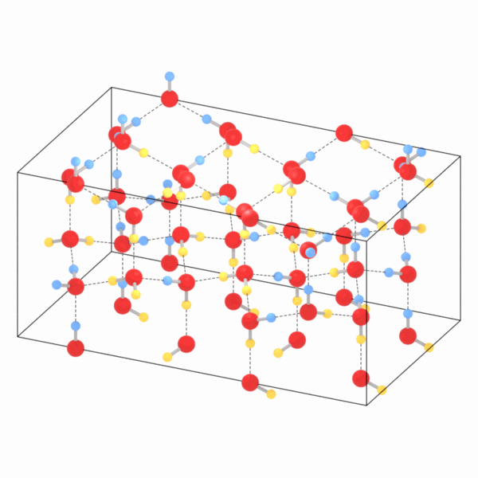

# Ice Ih (proton-disordered)

32 H2O in a 2x2x1 supercell of the 8-molecule orthohexagonal cell (9.04 x 15.66 x 7.37 A). The O lattice is ideal wurtzite-type (O...O about 2.77 A).

The protons are generated by `../make_structures.py` with a fixed seed: a random orientation of every O-O link is repaired by path reversal until each O donates exactly two H, then randomised by reversing directed loops. The script asserts the ice rules on the final coordinates and prints statistics:

- each O has exactly 2 H at 1.00 A and accepts exactly 2 H bonds (H...O about 1.77 A);
- each O...O link carries exactly one H.

The POSCAR species line is `O H1 H2`: H1 points up (positive c component of the O-H vector), H2 down. gemmy keeps those labels as style keys, so `config.json` colours them differently (blue and yellow). The config draws O-H covalent bonds (thick, grey) and H-bonds (thin, dark, `"style": "dashed"`; `"dotted"` also works) as two distance windows, each written for both H labels (`O`-`H1` and `O`-`H2`), since a rule names a label exactly.

Covalent bonds use `complete: ends`, so an H whose O is inside the display box but which itself lies across the boundary is still shown; H-bonds use `complete: none` (they add no atom, so they are drawn only between two atoms already shown). `tests/test_examples.py` checks that no H is left without its covalent bond.

`render.sh` also draws the cell box (`--cell-box.show True`).

Run `./render.sh` (needs `gemmy` on PATH or `GEMMY="uv run gemmy"`, and Blender); output goes to `./renders`.

`config.toml` and `config.json` are the same config in two formats; `render.sh` uses the TOML one.
