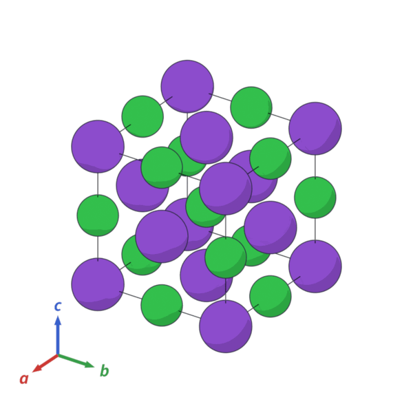

# NaCl (rock salt)

Conventional 8-atom cell, a = 5.640 A. Simple ball style: Na (purple, radius 0.95) larger than Cl (green, radius 0.75), no bonds, no polyhedra.

`periodic: true` plus the display box (`cells.box`, here the whole cell) shows every atom on a face, edge or corner on each boundary copy: the classic 27-atom cube (14 Na, 13 Cl). `render.sh` uses `--look.preset 3to2d`, which also draws the cell box (its edges run through the atoms, so they look like bonds).

Run `./render.sh` (needs `gemmy` on PATH or `GEMMY="uv run gemmy"`, and Blender); output goes to `./renders`.

`config.toml` and `config.json` are the same config in two formats; `render.sh` uses the TOML one.
