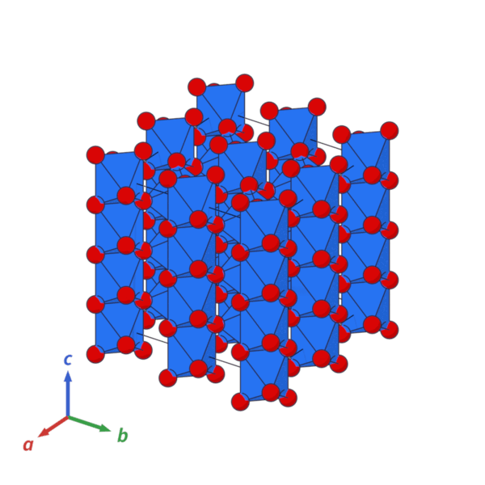
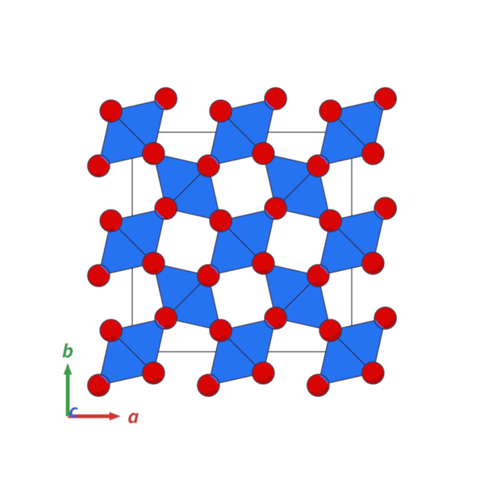

# Stishovite (SiO2, rutile type)

| Rotated view | Down c |
|---|---|
|  |  |

The high-pressure SiO2 polymorph: tetragonal P4_2/mnm, a = 4.1801 Å, c = 2.6678 Å, O at (x, x, 0) with
x = 0.3062, shown as a 2x2x3 periodic supercell. Si is six-coordinated (4 × 1.758 Å + 2 × 1.810 Å). The
SiO6 octahedra share edges in chains along c, and neighbouring chains share corners.

Polyhedra style for oxides: no bonds, Si spheres hidden (`"visible": false`) so only the SiO6 octahedra
show, saturated red O. `image_centers: true` also builds the octahedra around boundary copies of Si, so
the cell faces have no stray O.

Both pictures use `--look.preset 3to2d`: `stishovite.png` from the default rotated view, `stishovite_c.png`
looking down c. Rutile TiO2 is the same structure: change the element, a, c and x in
`examples/make_structures.py`.

Run `./render.sh`; output goes to `./renders`.

`config.toml` and `config.json` are the same config in two formats; `render.sh` uses the TOML one.
